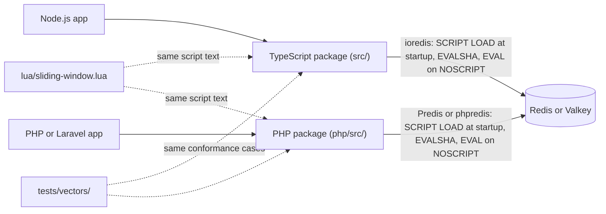

# redis-sliding-window

A small, hardened sliding-window rate limiter for Redis and Valkey: one atomic Lua script, with TypeScript and
PHP packages that share it.

Status: in development; the first release (v1.0.0) is planned (`docs/roadmap.md`). The contract (bucket keys, the
script's interface, both APIs, the failure policy and the test plan) is `docs/design.md`.

## Architecture

The application passes its own long-lived client; the library never opens connections. Each call runs the script
once: it reads the server's clock, drops entries older than the window, and either records the request or reports
when to retry. If the server cannot answer, the limiter fails open or closed, as the caller chose, and reports the
outage through the caller's callback; a server reply that rejects the credentials or the configuration throws.

So far the repository holds the contract, the shared test vectors and the build and test tooling; the script and
the limiters come next (roadmap RSW-2 and RSW-3).

License: MIT.
