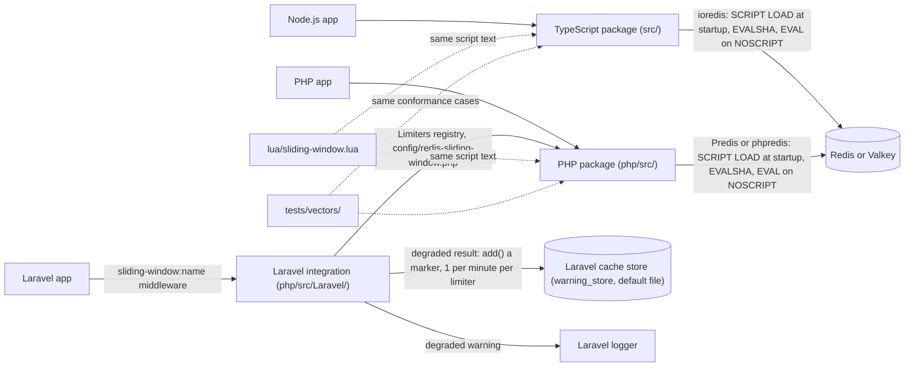

# redis-sliding-window

A small, hardened sliding-window rate limiter for Redis and Valkey: one atomic Lua script, with TypeScript and
PHP packages that share it.

- An exact sliding window (a sliding log), decided on the server's clock in one round trip.
- Safe under concurrent bursts: N simultaneous requests on an empty bucket with limit L allow exactly min(N, L).
- Results carry `allowed`, `remaining` and the retry time, ready for a `429` with `Retry-After`.
- An explicit fail-open or fail-closed choice when the server cannot answer, reported through your callback.
- TypeScript (ioredis) and PHP (Predis, phpredis, plus a Laravel middleware), tested against the same vectors.

Status: v1.0.0 is the first stable release; install it by pinning the `v1.0.0` tag (changes in `CHANGELOG.md`,
release process in `docs/release.md`). The contract (bucket keys, the
script's interface, both APIs, the failure policy and the test plan) is `docs/design.md`.

## Why a sliding window

A fixed-window counter (`INCR` plus `EXPIRE` per minute) resets at each boundary, so a client can send the full
limit at the end of one window and the full limit again at the start of the next: twice the limit in a moment.
A sliding window counts the requests of the last `windowMs` milliseconds at every call, so no span of `windowMs`
ever holds more than the limit. This library keeps one sorted-set entry per allowed request, which makes the
window exact (no estimate from weighted neighbouring counters) and lets a denied result say exactly when the next
request can succeed.

## Install

Releases are git tags; pin one. Nothing is published to the npm or Packagist registries yet.

TypeScript (Node.js 22+, ESM, ioredis):

```bash
npm install ioredis "github:georgimorozov/redis-sliding-window#vX.Y.Z"
```

PHP (8.3+, 64-bit, Predis 3.7+ or phpredis 6.3+), with a VCS repository in `composer.json`:

```json
{
  "repositories": [{ "type": "vcs", "url": "https://github.com/georgimorozov/redis-sliding-window" }],
  "require": { "georgimorozov/redis-sliding-window": "X.Y.Z" }
}
```

## Usage: TypeScript

```ts
import { Redis } from 'ioredis';
import { SlidingWindowLimiter, retryAfterSeconds } from 'redis-sliding-window';

// One long-lived client for the whole process (database 0, no keyPrefix).
const redis = new Redis({ host: '127.0.0.1', port: 6379, commandTimeout: 1000 });

export const loginLimiter = new SlidingWindowLimiter({
  client: redis,
  name: 'login',
  limit: 5,
  windowMs: 15 * 60_000,
  failMode: 'closed',
  onError: (report, context) => {
    // Use your structured logger or error tracker (Sentry, pino, ...), not console output.
    appLogger.warn(
      { limiter: context.name, failMode: context.failMode, reason: report.reason },
      report.message,
    );
  },
});
await loginLimiter.load(); // optional: SCRIPT LOAD at startup; throws if the server rejects it

const result = await loginLimiter.hit(clientIp);
if (!result.allowed) {
  // respond 429 with Retry-After: retryAfterSeconds(result)
}
```

`hit()` returns `{ allowed, remaining, retryAfterMs, resetAfterMs, resetAt, degraded }`. `retryAfterSeconds()`
rounds `retryAfterMs` up to whole seconds (at least 1 when denied, 0 when allowed).

### Express

```ts
import type { NextFunction, Request, Response } from 'express';

app.post(
  '/login',
  async (req: Request, res: Response, next: NextFunction) => {
    try {
      const result = await loginLimiter.hit(req.ip ?? 'unknown');
      if (!result.allowed) {
        res.set('Retry-After', String(retryAfterSeconds(result)));
        res.status(429).send('Too Many Requests');
        return;
      }
      next();
    } catch (error) {
      next(error);
    }
  },
  loginHandler,
);
```

Behind a proxy, set Express's `trust proxy` to the actual proxy addresses or hop count of your deployment (never
a blanket `true`), and make sure the last trusted proxy overwrites `X-Forwarded-For`. Otherwise a client can
rotate that header and get a fresh bucket per request.

### Hono

```ts
import type { Context } from 'hono';
import { createMiddleware } from 'hono/factory';

const rateLimit = (limiter: SlidingWindowLimiter, key: (c: Context) => string) =>
  createMiddleware(async (c, next) => {
    const result = await limiter.hit(key(c));
    if (!result.allowed) {
      c.header('Retry-After', String(retryAfterSeconds(result)));
      return c.text('Too Many Requests', 429);
    }
    await next();
  });

app.post('/login', rateLimit(loginLimiter, (c) => clientAddress(c)), loginHandler);
```

`clientAddress` stands for whatever your runtime or proxy guarantees (for example Hono's `getConnInfo` helper for
your adapter). A client can set `X-Forwarded-For` itself unless a trusted proxy overwrites it.

### Astro (server output, Node adapter)

This example needs an adapter that provides a trusted `context.clientAddress` (such as `@astrojs/node`); Astro
throws when the adapter provides none. On other adapters, use that platform's trusted client-address source.

```ts
// src/middleware.ts
import { defineMiddleware } from 'astro:middleware';

export const onRequest = defineMiddleware(async (context, next) => {
  if (context.url.pathname === '/api/login' && context.request.method === 'POST') {
    const result = await loginLimiter.hit(context.clientAddress);
    if (!result.allowed) {
      return new Response('Too Many Requests', {
        status: 429,
        headers: { 'Retry-After': String(retryAfterSeconds(result)) },
      });
    }
  }
  return next();
});
```

On long-lived Node servers, create the client and the limiters once, in a module the middleware imports, never
per request. This library needs a TCP Redis client such as ioredis, so serverless runtimes without one (for
example Cloudflare Workers, which also forbids reusing a client across requests) are not supported.

## Usage: PHP and Laravel

```php
use GeorgiMorozov\RedisSlidingWindow\FailMode;
use GeorgiMorozov\RedisSlidingWindow\SlidingWindowLimiter;

$redis = new Predis\Client([
    'host' => '127.0.0.1',
    'persistent' => true,
    'timeout' => 1.0,
    'read_write_timeout' => 1.0,
]);
$limiter = new SlidingWindowLimiter($redis, 'login', 5, 900_000, FailMode::Closed);

$result = $limiter->hit($_SERVER['REMOTE_ADDR']);
if (!$result->allowed) {
    http_response_code(429);
    header('Retry-After: ' . $result->retryAfterSeconds());
    exit;
}
```

In Laravel the service provider is auto-discovered. Define limiters in `config/redis-sliding-window.php`, then:

```php
Route::post('/login', LoginController::class)->middleware('sliding-window:login');
```

The middleware keys requests by the signed-in user's id, else the client IP, and answers a denied request with a
429 and `Retry-After`. During an outage it logs at most one warning a minute per limiter, through Laravel's
logger, using a marker in the cache store named by `warning_store` (default `file`; never Redis; `null` logs
every degraded result). Configuration, the connection (it needs an empty key prefix), phpredis and the `onError`
callback: `docs/php.md`.

## Failure policy

Every limiter is constructed with a required `failMode`; there is no default.

- **Outages degrade.** No reply from the server (connect failure, timeout, closed connection) or a transient
  server state (`LOADING`, `BUSY`, `MASTERDOWN`, `READONLY`) returns a result with `degraded: true`: allowed
  under `open`, denied under `closed` (retry after `windowMs`). `onError(report, context)` runs once for each
  degraded result, with the reason and the limiter's name, never the identifier; whatever the callback throws
  never changes the result, and `hit()` does not throw on an outage.
- **Misconfiguration throws.** A server reply that rejects the credentials or the configuration (`NOAUTH`,
  `WRONGPASS`, `NOPERM`, `OOM`, `ERR` and others) throws in both modes, so a broken deploy is loud.

Fairness quotas (API limits, per-user burst caps) usually fail open: a limiter outage should not become a product
outage, and the worst case is some unthrottled traffic while it lasts. Fail closed where a flood is harmful and
the caller is unauthenticated: sign-in links, password resets, SMS, contact forms, sign-up, guessable secrets. A
timeout does not tell whether the script ran, so a degraded request may still count. Details: `docs/design.md`,
"Failure policy".

## Connections

The library never opens connections; you pass a client. Use one long-lived client per process (ioredis), or
persistent connections per worker (PHP-FPM: Predis `persistent`, phpredis `pconnect()`), with short connect and
command timeouts so an outage degrades quickly instead of holding requests. A fresh connection per request,
especially a fresh TLS connection, is a known failure mode: every request pays the handshake, and under load the
handshakes exhaust the server's or a proxy's connection capacity.

## Performance

No benchmark numbers are published: latency depends on the network and the server far more than on this code.
What each call costs:

- **One round trip.** `hit()` sends `EVALSHA`, plus one `EVAL` when the server has not cached the script yet.
- **Server work:** `TIME`, `ZREMRANGEBYSCORE`, `ZCARD` and `ZSCORE`, then `ZADD` and `PEXPIREAT` when allowed or
  a `ZRANGE` by rank when denied: O(log N) each, plus the expired entries removed, where N is the entries in the
  bucket (at most the limit, unless a limit was lowered).
- **Memory:** one sorted set per identifier, holding one 32-character member per request allowed in the last
  window, so up to `limit` entries per key. A key expires on its own once its newest entry ages out.

Very large limits per identifier (tens of thousands per window) mean large sorted sets; a fixed or approximate
window suits those better.

## Limits

- One node: a standalone server or a primary, Redis 7.2+ or Valkey 7.2+. No Cluster clients in v1.
- ioredis: database 0 and no `keyPrefix`. Predis and phpredis: no client-level key prefix.
- One hit per call (no weighted hits) and no read-only check.
- Durability is the server's own: a restart without persistence forgets the windows.

## Architecture



Each call runs the script once: it reads the server's clock, drops entries older than the window, and either
records the request or reports when to retry.

License: MIT.
